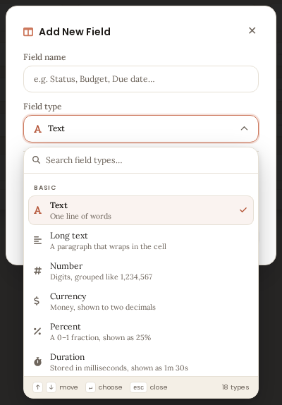
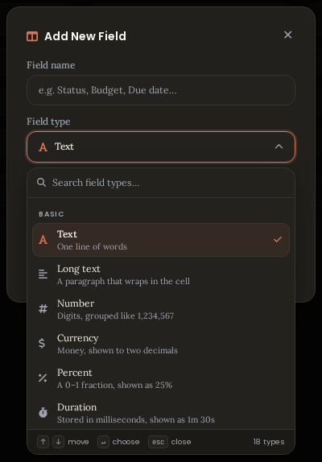
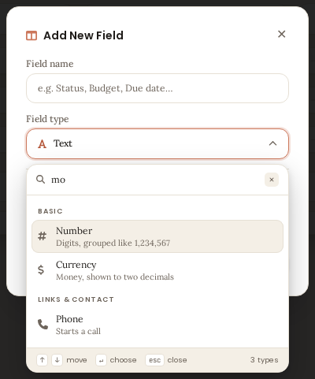
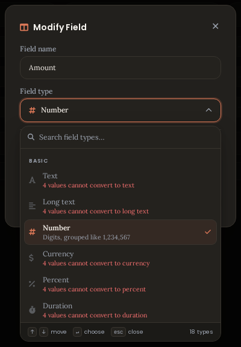
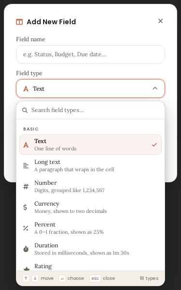

# COD-76 — the field type list is the plugin's own

**Date:** 2026-10-17 · **Repo:** `258044aamm-Dev/Tablify` · **Issue:**
[COD-76](https://linear.app/code-bro/issue/COD-76/he-field-type-selection-drawer-ui) (priority 2,
Improvement + Feature)
Plan: [`docs/plans/cod-76-field-type-picker-plan.md`](../plans/cod-76-field-type-picker-plan.md) ·
Design mock: [`cod-76/field-type-picker-mock.html`](cod-76/field-type-picker-mock.html) ·
Shipped captures: [`cod-76/shipped/`](cod-76/shipped/)

## The finding that shaped the fix

The list the ticket is about was **not the plugin's**. `AddFieldModal` rendered:

```ts
const typeSelect = typeWrap.createEl('select', { cls: 'tablify__pmodal-input' });
```

so the closed row was ours and the open list was the platform's — `one word per row`, unthemeable,
and on Android the OS dialog. Worse, in Modify mode the list was **filtered** by
`offersType()`: a type that would drop values was not rendered at all, so the list changed shape
between Add and Modify with nothing on screen saying why.

```
before   <select> + <optgroup>        → platform popup; refused types simply absent in Modify
after    [data-testid="tablify-field-type-panel"]  → the plugin's own panel (DOM, CSS, theme tokens)
```

## What shipped

| File | Role |
|---|---|
| `src/views/grid/fieldTypePicker.ts` *(new)* | `FIELD_TYPE_META` (icon, one factual description and search keywords for all 21 model types), `TYPE_GROUPS` (moved here from the window, re-exported there), the trigger, the panel: search, groups, rows, keyboard, placement, dismissal |
| `src/views/grid/AddFieldModal.ts` | the native `<select>` replaced by the picker; `typeBlockReason` option; `blockReasonFor()`; `onClose()` closes a panel that lives on `body`; `TYPE_GROUPS` re-exported at the old address |
| `src/menus/tableMenuModel.ts` | `TYPE_LABELS` gains *Auto number*, *Created time*, *Last modified* — a system field's own type used to read as `auto_number` in Modify |
| `src/views/tableView.ts` | passes `typeBlockReason` beside `canPickType`, using the sentence `planTypeChange` already produces |
| `styles.css` | one new `/* ---- field type picker (COD-76) ---- */` section, lines 3333–3976. **No existing selector edited** |
| `main.js` | the build |

**Not touched:** the store, `planTypeChange` and every conversion rule, `createEditCellCommand`,
`showTypeRows()` and the rest of the window, the save path, the schema, `FORMAT_SPEC.md`,
Airtable sync, the filter builder, import/export, cell renderers, and every other panel.

## Behaviour, in the terms the ticket asked for

| Requirement | Where it is met |
|---|---|
| "layout, spacing, typography" | 39 px trigger · 10/12 search row · 42 px rows on a 14 + 1fr + 12 px grid · 9/12 sticky group headings · 348 px list cap · 26 px hint bar. The trigger is **39 px — exactly the box the native select had**, so every offset below it in the card is unchanged (measured against `main`) |
| "polished, modern" | the same tokens, radii, shadow and paint (`bgPill`) as the select, attachment and date panels — one visual language |
| "preserving the existing functionality" | the same 18 types in the same 5 groups, the same `showTypeRows()` call on pick, the same save path; three existing suites (`addFieldModal`, `fieldEditorModal`, `tableView`) still pass without changing what they assert about behaviour |
| "across supported screen sizes" | the list is capped to the room the chosen side has, the panel flips above the trigger when that side is roomier, clamped into the viewport — captured at 1568×795 and 390×844 |
| "light and dark modes" | every colour is a theme variable; both themes captured |

### The point of the ticket: blocked types keep their place

| | Add New Field | Modify Field, type convertible | Modify Field, type would lose values |
|---|---|---|---|
| row count | 18 | 18 | **18** |
| row state | selectable | selectable | `aria-disabled="true"`, greyed name, reason in `textDanger` |
| reason text | — | — | `planTypeChange`'s own sentence: *4 values cannot convert to text* |

The field's own type is never blocked, and it stays pickable after switching away (the window
remembers `openedType`), so a pick is never a one-way door.

## Verification

### Unit — `npm run test`

| Suite | Result |
|---|---|
| `tests/views/grid/fieldTypePicker.test.ts` *(new)* | **61 pass** — catalogue, trigger, open/close, search, keyboard, blocked rows, placement, in-window wiring, axe |
| `tests/views/grid/typePickerSupport.ts` *(new)* | the only module that knows the panel lives on `body` |
| `tests/views/addFieldModal.test.ts` | 25 pass (re-pointed at the panel) |
| `tests/views/grid/fieldEditorModal.test.ts` | 22 pass (+2: greyed-not-hidden, `typeBlockReason`) |
| `tests/views/tableView.test.ts` | 28 pass (picks through the UI) |
| `tests/ui/contrast.test.ts` | 17 pass (+2: every pair the panel paints, both themes) |
| **Whole suite** | **123 files / 1929 tests** pass (was 122 / 1863 → **66 new**), 0 failures |

`npm run lint` → **0 errors, 119 warnings — the same count `main` has**, so the picker adds no new
warning.

### Browser — `npm run test:fields` (real Chromium, production `TableView`)

**102/102 pass**, unchanged: this ticket changes a dialog, not a cell.

### Visual — parity is still protected, the one intentionally-changed row is masked

`npx tsx tests/visual/capture-add-field.ts --theme all --viewport all --out …` now blanks the
Field type row in **both** the plugin and prototype images before comparing (it is the control the
ticket replaces) and reports the percentage over the pixels that remain. 20 combinations:

| combo | text | select | number | formula | link |
|---|---|---|---|---|---|
| dark · owner | 0.14 % | 0.11 % | 0.14 % | 0.12 % | 0.13 % |
| dark · mobile | 0.17 % | 0.12 % | 0.17 % | 0.13 % | 0.15 % |
| light · owner | 0.94 % | 0.77 % | 0.94 % | 0.67 % | 0.46 % |
| light · mobile | 0.70 % | 0.56 % | 0.69 % | 0.45 % | 0.78 % |

`main` measured 0.48–0.83 % on the same board with the old select; with that row masked the card
still matches to roughly a percent, which is the "nothing else moved" claim in checkable form.
Sizes are identical in 19 of 20 cases; `light · owner · link` is 397 vs 399 (two rows — the wrap of
a link hint below the masked band).

### The shipped control, captured

`npx tsx tests/visual/capture-add-field.ts --theme all --viewport all \
  --evidence docs/evidence/cod-76/shipped` shoots the picker itself — the plugin-only shots the
prototype has nothing to compare against. Twelve files, `{theme}-{viewport}.type-{open,search,blocked}.png`:

| Light, desktop | Dark, desktop |
|---|---|
|  |  |
|  |  |



### Accessibility

* `axe-core` over the open panel: **no critical or serious violations** (`fieldTypePicker.test.ts`).
* Colour pairs, measured in `tests/ui/contrast.test.ts` (panel = `bgPill`, current row = 9 % accent
  tint). Light: name 17.14, description 5.71, description on the tint 5.20, name on the tint 15.63,
  check 4.78 (4.36 tinted), blocked name 5.71, blocked reason (danger) 4.83, group heading 5.71,
  hint 4.98. Dark: 12.92 / 6.25 / 5.51 / 11.38 / 5.09 (4.48) / 6.25 / 5.74 / 6.25 / 6.85.
* Why the current row's glyph uses `textToday` and not the accent: the raw accent is **3.28:1** on
  the light panel and **2.99:1** on its own tint — short of the 3:1 a 13 px glyph owes. `textToday`
  is the AA terracotta COD-75 added.
* Why a blocked row is not faded as a whole: opacity would take the reason to ~2.5:1, and the
  reason is the point of the row. Only the decorative glyph fades (0.45).
* ARIA: trigger is a `button` with `aria-haspopup="dialog"`, `aria-expanded` and the accessible name
  *Field type: Text*; the search is a `combobox` with `aria-controls` / `aria-activedescendant`; the
  list is a `listbox`, groups are `role="group"` labelled by their own heading, rows are `option`
  with `aria-selected` / `aria-disabled`; focus moves into the search on open and back to the
  trigger on close; `Tab` closes the panel rather than trapping focus.

## Constraints checked

- **Escape / Enter never reach the Obsidian modal.** The panel's key handler calls
  `preventDefault()` + `stopPropagation()` for both; a document-level listener in
  `fieldTypePicker.test.ts` never sees them, and `addFieldModal.test.ts` still proves Enter-in-name
  submits. Escape closes the list and only the list.
- **Create mode blocks nothing and hides nothing:** 18 rows, no `aria-disabled`.
- **No native `<select>` is left in the window** apart from the link target's own (which is a
  different row): asserted with a `.tablify__typepicker select` count of 0.
- **The panel lives in `document.body`** (like the select and date panels), `z-index: 1000`, so an
  `overflow: auto` modal cannot clip it and re-rendering cannot take it down. `AddFieldModal.onClose`
  closes it, so it cannot outlive the window.

## What could not be verified headlessly

Obsidian's own mobile behaviour: whether the soft keyboard opens when the search takes focus. The
picker deliberately does **not** focus the search when `matchMedia('(pointer: coarse)')` matches —
the keyboard would cover the list — and scrolls the current group into view instead. That is the
one manual item.

## Manual check in Obsidian (~3 minutes)

1. Add Field → **Field type** → the panel opens under the row, in the theme's colours; **Esc** closes the list, not the window.
2. Type `mo` → Number, Currency, Phone; **Enter** picks the highlighted one.
3. Pick *Date and time* → the rows below change as before; **Save Field** adds the column.
4. **Modify field…** on a Number column that holds text → every type is listed; the ones that would lose values are greyed with *N values cannot convert to …*; the current type is ticked and still pickable.
5. Switch Obsidian to dark → every part of the panel is themed.
6. On a phone: tap **Field type** → the panel fits the screen (flipping above the row when needed), the list does not raise the keyboard on open, and one tap on the search does.

## Notes

- `TYPE_GROUPS` moved to `fieldTypePicker.ts` and is still exported from `AddFieldModal.ts` at its
  old address, so nothing that imported it had to change.
- `canPickType` (boolean) is unchanged and still works; `typeBlockReason` (string | null) is the
  richer sibling the picker prefers. Both are optional, so no call site was forced to change.
- The search matches **name + description + a hand-written keyword list**, not fuzzy text: `mo`
  finds Number, Currency and Phone, and `format` finds nothing — predictable, and testable without
  a scoring function.
- Four test files and one capture script used to set the native select by hand; all of them now go
  through the picker, so CI cannot pass against a control that no longer exists.
