# COD-77 — cell focusing: a tap outside the table drops the focused cell

**Issue:** [COD-77](https://linear.app/code-bro/issue/COD-77/cell-focusing) · *Improvement*, *UI-UX* · p2
**Delivered:** `9f556b0` (step 1) · step 2 = this evidence · status **In review**

> When a cell is focused, tapping anywhere outside that cell should remove its focus.
> The cell should lose focus immediately when the user taps outside it.

## The finding

The capsule outline (`2px solid var(--tablify-selection)`, painted in place by
`GridView.paintSelection`) was never un-painted except by selecting another cell, a
grouping change, or a model swap. Nothing listened for a press outside the table, so the
highlight stuck to the cell until something else selected it — on a phone, where the grid
fills the screen, that is the whole complaint in the ticket.

The plugin's own prototype had the answer, unported:
[`Prototype/script.js:866`](../../Prototype/script.js) — `outsideTapClear`, registered on
`mousedown` + `touchstart`, commented *"Tapping/clicking anywhere outside the grid clears
the focused-cell highlight"*. Step 1 ports it, with the keep-zones the prototype used
mapped onto Tablify's DOM:

| Prototype keep-zone | Tablify analogue | Press inside it… |
|---|---|---|
| `#mainTable` | `.tablify__header, .tablify__viewport` | keeps — a normal grid press (move, toggle, drag) |
| `#floatPanel` | `.tablify__panel` | keeps — every picker card (`createPanelCard`) |
| menus render in `#floatPanel` | `.menu, .menu-container` | keeps — Obsidian draws menus at document level |
| the modal id list | `.modal-container` | keeps — Add Field, Options, Filter, Formula, Link picker |
| `#cellEditor` inside the cell | the open editor element | keeps — its floats in the grid root but outside the viewport, so it needs its own check |

Everything else — the toolbar, the title row, another pane, the workspace, and the
Insert Row pill (outside `#mainTable` in the prototype too, so parity, not a special case)
— drops the highlight. If an editor is open, the press commits it first through its own
blur path (one undo step, never lose input), then clears; an invalid value keeps both the
editor and the highlight, as COD-70's rule demands.

The listener is a document-level **`pointerdown` in the capture phase**. Capture is
deliberate: `wireEditSwitchPress` commits an open editor during the bubble phase, and that
commit's re-render detaches the press target before a bubble listener could ask it
`closest()` — an inside-grid press would have looked "outside". COD-70's own suite caught
this before the first commit.

## What shipped

| File | Change |
|---|---|
| `src/views/tableView.ts` | `outsideTapClear` handler, `wireOutsideTapClear()` (wired in `renderGrid`, unwired in `clear`) |
| `tests/views/cellFocus.test.ts` *(new)* | 13 cases |
| `tests/visual/capture-cell-focus.ts` *(new)* | the evidence capture, self-verifying |
| `docs/evidence/cod-77/shipped/` *(new)* | 12 shots + `report.md` |

No existing selector, class name, or handler was edited; the listener is additive and
never calls `preventDefault`, so the long-press, drag and press-detection flows are
untouched. Row selection (SAD-114) is a different UI state and is not touched.

## Requirement table

| Ticket asks | Ships |
|---|---|
| tapping outside the cell removes focus | a document `pointerdown` outside every keep-zone calls `setSelection(null)` |
| **immediately** | at press time (`pointerdown`), not at click — the highlight is gone before the finger lifts |
| preserves existing functionality | all 12 existing suites unchanged and green; inside-grid presses keep/move the highlight exactly as before |
| across supported screen sizes and themes | evidence below: owner / desktop / mobile × dark / light |

## Unit tests — `tests/views/cellFocus.test.ts` (13)

| Case | Pins |
|---|---|
| press outside the grid (`view.contentEl`) | selection, `aria-selected` and capsule outline all gone |
| press on empty grid surface | kept |
| press on the header | kept |
| press on the Insert Row pill | cleared (prototype parity), and no row added by the press alone |
| press inside a `.tablify__panel` | kept |
| press on a `.menu` | kept |
| press on a `.modal-container` | kept |
| editing + press outside | value committed to the file, editor removed, highlight cleared |
| press inside the open editor | editor and highlight both kept, nothing written |
| invalid value + press outside | editor and highlight kept (the existing blur rule) |
| nothing focused + press outside | no-op, no throw |
| press on another cell | the press alone does not clear; the click still moves the selection |
| `clear()` | the listener is unwired |

## Browser evidence — `cod-77/shipped/`

Each pair: the grid with one cell focused, then the same grid after a real
`pointerdown` on the toolbar (outside the table surface). The capture asserts the DOM at
both steps — exactly one `.tablify__cell--selected` after the click, zero after the
press — so a shot cannot ship without the behavior it claims to show.

| Combo | Focused | After the outside press |
|---|---|---|
| dark · owner | 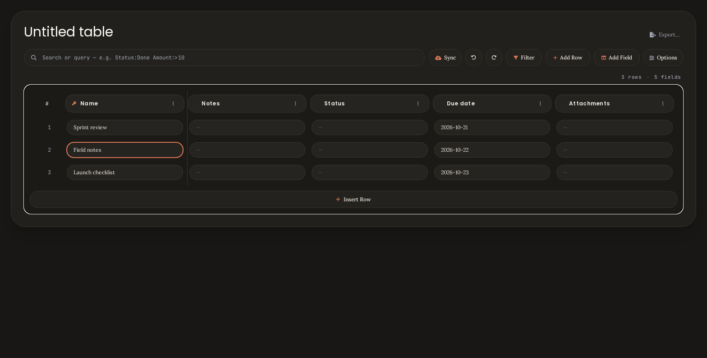 | 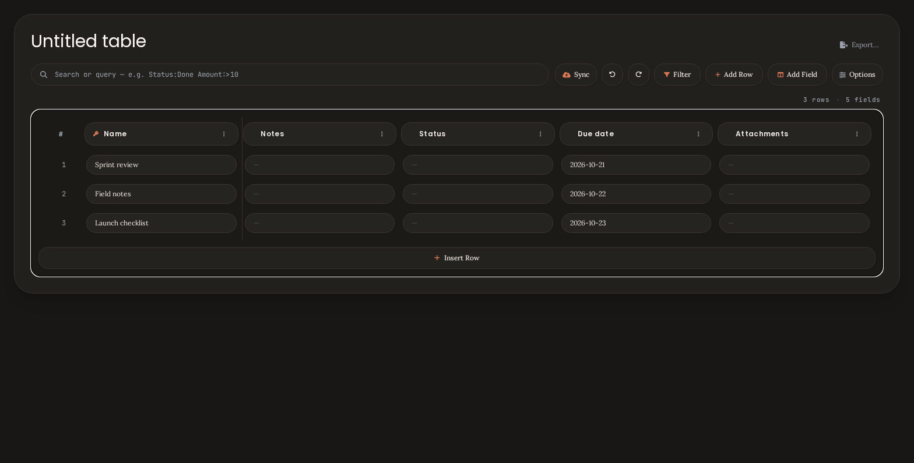 |
| dark · desktop | 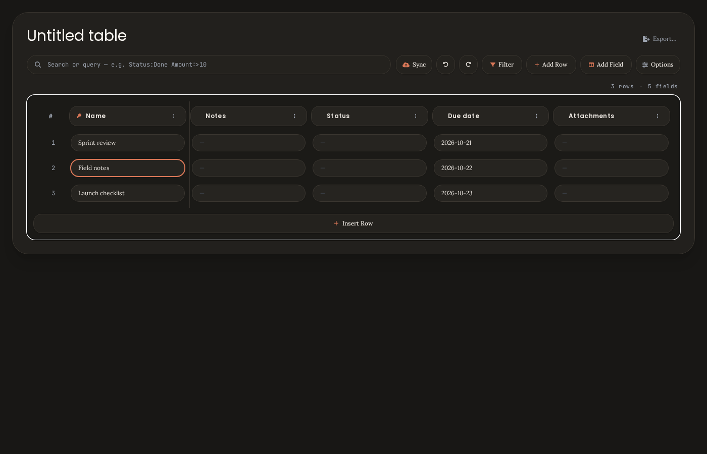 | 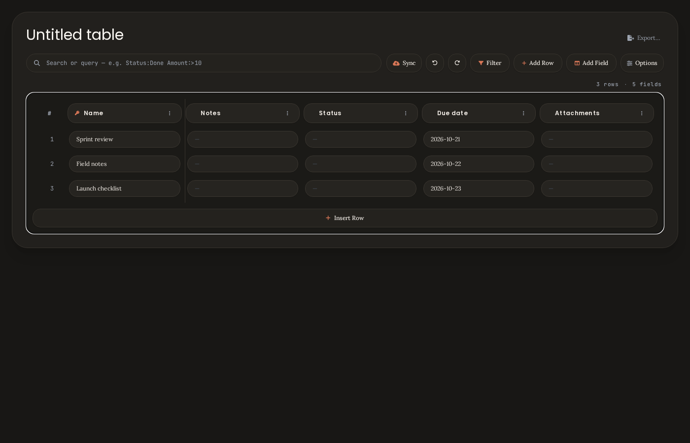 |
| dark · mobile | 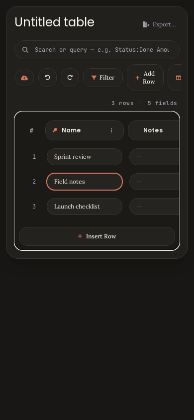 | 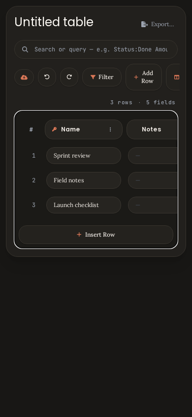 |
| light · owner | 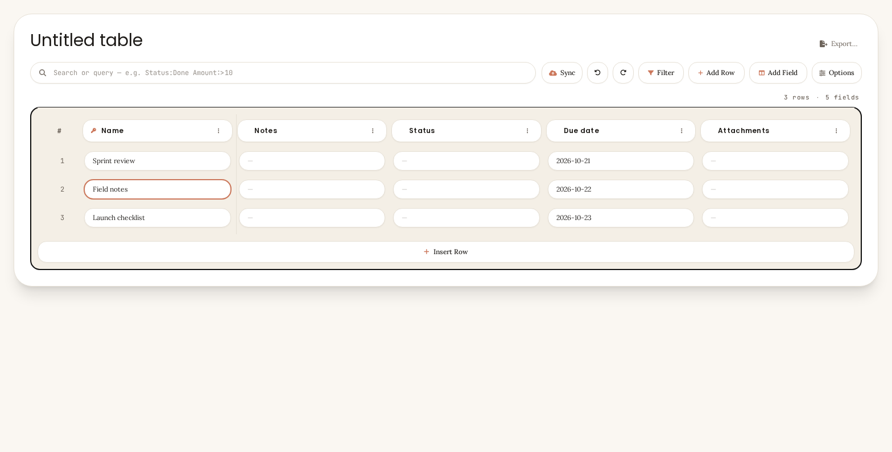 | 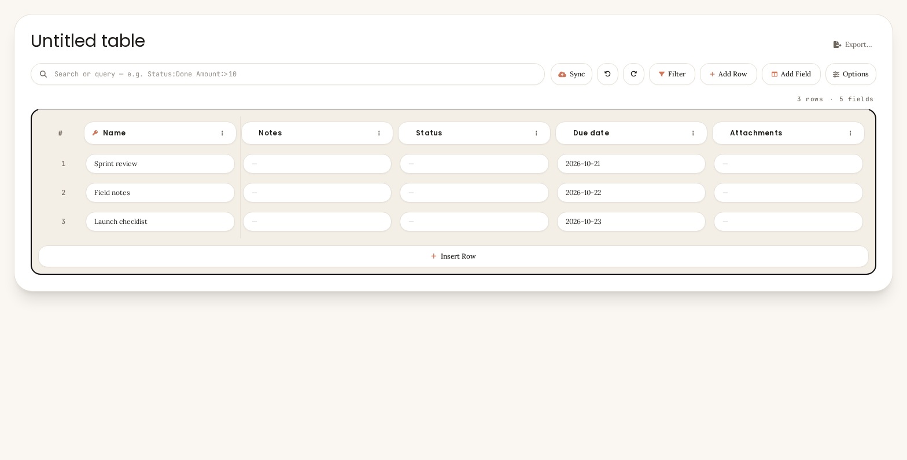 |
| light · desktop | 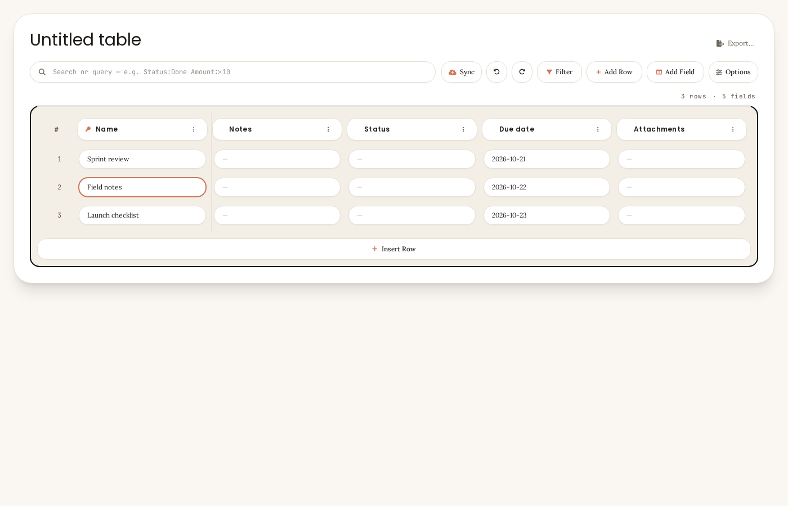 | 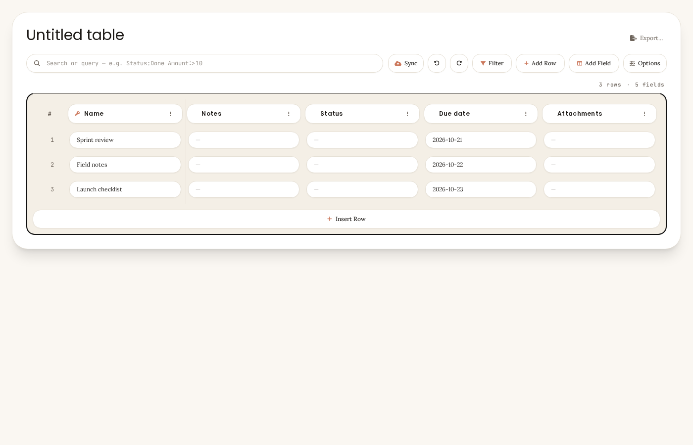 |
| light · mobile | 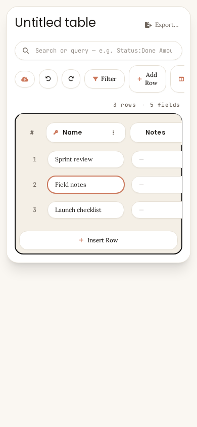 | 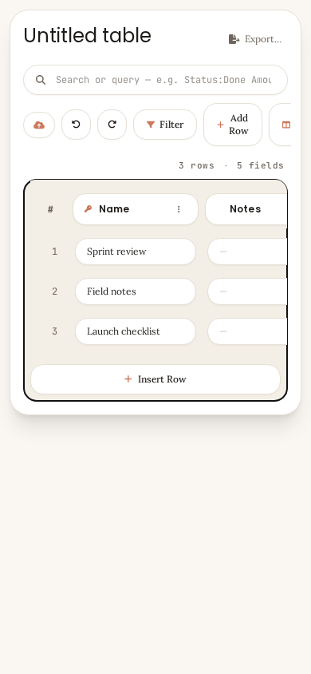 |

**Pixel check:** for every combo, the two shots differ only inside the focused cell's
rectangle — measured on dark/owner: 1177 changed pixels, **100% inside the cell ±6 px, 0
outside** (the 2 px outline ring around the capsule plus its anti-aliasing). No other
pixel in the card moves, which is also the proof that clearing re-renders nothing.

## What could not be verified here

- **Real touch hardware.** The capture drives a real `PointerEvent` (`pointerType:
  'mouse'`) in Chromium; a finger on a phone produces the same event type, but the
  long-press menu's timing on real devices is a manual check.
- **Obsidian's own chrome.** The harness page mimics a leaf; taps on the Obsidian
  sidebar/ribbon clear the highlight through the same document listener, but were not
  screenshotted.

## Manual check (~1 minute)

1. Click a cell — the capsule outline appears.
2. Click the toolbar, the title row, or another pane — the outline is gone the instant
   the press lands.
3. Double-click a cell to edit, type, then click the toolbar — the value is saved
   (one undo step) **and** the outline is gone.
4. Type an invalid value (e.g. letters in a Number cell), click outside — the editor
   stays put, so does the outline.
5. Phone: tap a cell, tap the Insert Row pill — the outline drops, then the row lands.
