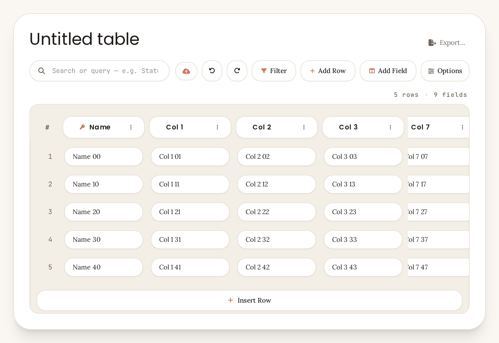
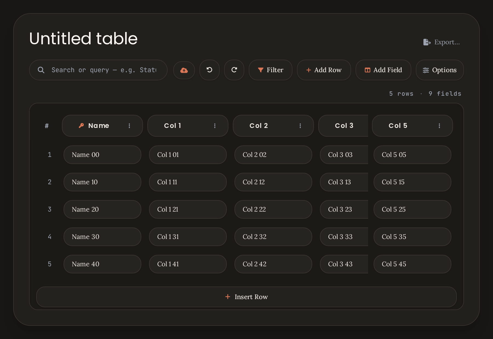

# COD-72 — Column freezing: investigation report

**Status:** investigation record (written before implementation; the fix is in
[`docs/evidence/COD-72.md`](../evidence/COD-72.md)).
**Issue:** COD-72 (p1, Improvement + Feature, project Tablify) — state *Todo*.
**Method:** read the model / render / menu code; drove the real `TableView` in the visual harness
(9 text fields × 150px, rows of real data) at 900px, 1400px and 600px; measured painted geometry,
scroll extents and menu states; captured screenshots.

---

## 1. How freezing works today

### 1.1 The model — a **count from the left**, not a set of columns

```ts
// src/model/view.ts:72
export function effectiveFrozenColumns(view, paneWidth): number {
  const stored = Math.max(0, Math.round(view.frozenColumns ?? 0));
  if (freezeModeOf(view) === 'viewport' && paneWidth <= MOBILE_PANE_MAX_WIDTH) return 0; // 639px
  return stored;
}
```

- `frozenColumns = N` means **“pin the `#` gutter plus the first N *visible* fields”** — a prefix.
  It cannot express “pin column 5 and nothing else”.
- The format itself says so: `tablify.schema.json:328` — *“Number of frozen columns from the left.”*
- Default view: `frozenColumns: 1`, `freezeMode: 'viewport'` (`src/model/view.ts:86`).
- `freezeMode: 'viewport'` = follow the pane (0 at ≤ 639px); `'fixed'` = the user touched it, apply everywhere.
- `setFrozenColumns(view, n, fields)` (`src/views/grid/columns.ts:46`) clamps `0..fields.length`
  and forces `freezeMode: 'fixed'`.

### 1.2 The rendering

`GridView.measure()` (`src/views/grid/GridView.ts:647`) computes slot widths and cumulative
`slotLefts`; `placeSlot()` (`:694`) makes every slot with `slot < 1 (lead) + frozenColumns`
`position: sticky` with `left = slotLefts[slot]`, `z-index` 1 in the body, 2 in the header.

Because `slotLefts` is the distance from the **first** slot, the geometry is only correct for a
prefix — which is exactly the model. The approach itself is sound and cheap (one scroll container,
no scroll mirroring).

The only frozen styling is a mask (`styles.css:2300`):

```css
.tablify__cell--frozen, .tablify__lead--frozen {
  background-color: var(--tablify-bg-inner);
  box-shadow: 6px 0 0 var(--…), -6px 0 0 var(--…), 0 8px 0 var(--…), … ;
}
```

There is **no divider / edge shadow** at the frozen boundary — the mask paints 8px of background
around every frozen cell, nothing more.

### 1.3 The three entry points

| Entry point | What it writes | Notes |
|---|---|---|
| Header ⋮ → **“Freeze column”** (`src/menus/tableMenuModel.ts:167`) | `frozenColumns = col + 1`, `freezeMode: 'fixed'` (`src/views/tableView.ts:1078`) | Enabled unless `frozenColumns === col + 1`. **No unfreeze item.** |
| Options → **“Freeze primary column”** switch (`src/views/grid/toolbar.ts:653`) | `onFreezeColumns(0 \| 1)` | All-or-nothing; reads the *effective* count (`tableView.ts:226`). |
| View file / defaults | `frozenColumns`, `freezeMode` | Default 1 + `viewport`. |

---

## 2. Scenario 1 — primary column already frozen, then freeze another column

Setup: 900px window → pane **792px**, content 768px, table 1480px wide; default freeze (1 = Name).

| Step | Stored | Painted | Result |
|---|---|---|---|
| Default | 1 (`viewport`) | 1 | Name pinned at the left edge. |
| Header ⋮ on **Col 3 → “Freeze column”** | **4** (`fixed`) | 4 | Name, Col 1, Col 2, **Col 3** pinned: `left` 46 / 202 / 358 / 514, z-index 2 (header) / 1 (body). Block ≈ 683px. |
| Scroll to 500px | 4 | 4 | The block stays pinned; Col 7 slides underneath and is **clipped mid-capsule** at the boundary (`repro/cod72-s1-scrolled.png`). |



**What is right:** positions and stacking are correct; the freeze holds while scrolling; column
resize and width persistence keep working (`slotLefts` is recomputed in `measure()`).

**What is wrong:** the user asked to freeze **Col 3** and got **four** columns — including the
primary column, which was already frozen, so the result *looked* right here by accident. On the
boundary itself the item is **disabled** (“Already frozen through this column”), so there is no way
to undo the freeze from the header menu.

---

## 3. Scenario 2 — primary column **not** frozen, then freeze another column

| Step | Stored | Painted | Result |
|---|---|---|---|
| Options → freeze off | 0 (`fixed`) | 0 | Nothing pinned. |
| Header ⋮ on **Col 5 → “Freeze column”** | **6** (`fixed`) | 6 | Name…Col 5 all pinned. |
| 600px window | 6 (`fixed`) | 6 | Block ≈ 991px in a 540px pane. |



**Answer to the issue’s question — does it freeze *independently*? No.** Freezing Col 5 with the
primary unfrozen re-freezes the primary **and** every column between them: the freeze is a prefix,
so a single “Freeze column” click can only ever extend it from the left edge. The action is not
wrong *given the model*, but the label promises something the model cannot deliver.

And the result is worse than cosmetic:

- **900px pane, 6 frozen at max scroll:** the frozen block (≈995px) is wider than the pane (792px).
  Measured `uncoveredByFrozen = []` — at **any** scroll position no non-frozen column is ever
  visible. Col 6, Col 7 and Col 8 are unreachable. (`repro/cod72-occlusion-900.png`)
- **600px pane, 6 frozen:** block ≈ 991px vs 540px — the same total occlusion one window size
  earlier. (`repro/cod72-narrow-fixed.png`)
- `effectiveFrozenColumns` only suppresses the freeze for `viewport` mode at ≤ 639px; an explicit
  (`fixed`) choice is never checked against the pane width, so the “can’t scroll to the rest”
  case is reachable from ordinary use (freeze 6 columns on a laptop, then narrow the window).

---

## 4. Findings

Severity: **S1** blocks the scenario, **S2** wrong/unsafe behaviour, **S3** polish.

### F1 — “Freeze column” is a prefix action with a label that implies a single column (S1)
*Current:* freezing Col N pins the primary + everything to its left.
*Expected:* either the label tells the truth (“Freeze up to this column”), or the action pins only
that column. The current label is the one thing the model can’t honour.
*Root cause:* `frozenColumns` is a count (`src/model/view.ts:72`, schema `:328`); the header item
writes `col + 1` (`src/views/tableView.ts:1080`).

### F2 — The header menu cannot unfreeze, and on a frozen column it **silently unfreezes others** (S1)
Measured menu states for `frozenColumns = 4` (cols 0…4):

| Column | Item | Enabled | What clicking it does |
|---|---|---|---|
| 0 (Name) | Freeze column | **yes** | sets count **1** → unfreezes Col 1-3 |
| 1 | Freeze column | **yes** | sets count **2** → unfreezes Col 2-3 |
| 2 | Freeze column | **yes** | sets count **3** → unfreezes Col 3 |
| 3 | Freeze column | no (“Already frozen through this column”) | — |
| 4 | Freeze column | yes | sets count 5 |

So on an already-frozen column the item labelled **“Freeze”** performs an **unfreeze**, with no
warning. The only real unfreeze is Options → switch, which is all-or-nothing (0 ↔ 1) and, with 4
frozen, quietly discards all four.
*Root cause:* single item `header.freeze` with `enabled: frozenColumns !== colIndex + 1`
(`tableMenuModel.ts:167`); no `header.unfreeze*` handler (`tableView.ts:1078`).

### F3 — No visible frozen boundary (S2)
While scrolling, a normal column is cut **mid-capsule** against the frozen block, with no divider,
shadow or tint to explain it (`repro/cod72-s1-scrolled.png`, right edge). The 8px mask also bleeds
over the neighbouring column, so in dark theme the frozen cells appear as square patches sitting on
top of rounded capsules (`repro/cod72-occlusion-900.png`).
*Root cause:* `styles.css:2300` — mask only; the last frozen slot gets no edge treatment.

### F4 — A frozen block may exceed the pane, making every other column unreachable (S1)
Measured: 6 frozen → block ≈ 995px; pane 792px (900px window) and 540px (600px window). At max
scroll no non-frozen cell is within the visible area (`uncoveredByFrozen = []`). The horizontal
scrollbar still moves, but only content *under* the frozen block moves.
*Root cause:* `measure()` clamps the count to `fields.length`, never to what the pane can hold
(`GridView.ts:668`); `effectiveFrozenColumns` only guards `viewport` mode at ≤ 639px.

### F5 — Freeze follows *positions*, so reorder and hide silently change which columns are frozen (S2)
- Freeze 3 (Name, Col 1, Col 2) → drag **Col 2 to the end** → still 3 frozen, but now
  Name, Col 1, **Col 3**: the freeze jumped to a column the user never froze.
- Freeze 3 → **hide Col 1** → frozen becomes Name, Col 2, **Col 3**: the boundary grew by one.

*Root cause:* the stored value is a count; `moveColumnOnto` / `hideField`
(`src/views/grid/columns.ts:100`, `:138`) never adjust it.
*Consequence for the design question:* making “this column” mean an identity would require storing
field ids (new view key, schema/format change, sync + export surfaces) — see §6.

### F6 — The Options switch describes the primary column but controls all of them (S3)
With 4 frozen the switch reads **“Freeze primary column” = on**; turning it off clears **all four**.
With `viewport` mode at ≤ 639px the switch correctly shows *off* (it mirrors the effective count),
so the mismatch only appears for `fixed` multi-column freezes.

### F7 — Validation clamps against *all* fields, rendering against *visible* fields (S3)
`validateView` clamps `frozenColumns` to `fields.length` (`src/model/view.ts:254`), while the grid
renders against `visibleFields(...)`. A view with hidden columns can therefore store a count larger
than the number of visible columns (renders as “everything frozen”). Low impact, but the two
clamps should agree.

---

## 5. Current vs expected

| # | Action | Current | Expected |
|---|---|---|---|
| 1 | Freeze with primary frozen | Pins prefix, works | Same result, but the menu must say what it does |
| 2 | Freeze with primary **not** frozen | Re-freezes primary + all to its left | Explicit, predictable; user must be able to choose |
| 3 | Unfreeze from header menu | **Missing**; item on a frozen column silently unfreezes others | “Unfreeze” / “Unfreeze all” items, state-aware |
| 4 | See where the frozen block ends | Nothing (clipped capsule) | Divider + edge shadow |
| 5 | Many frozen columns on a narrow pane | Everything else unreachable | Frozen area never eats the whole pane |
| 6 | Reorder / hide a frozen column | Freeze silently moves | Freeze must not silently extend; hide shrinks the count |
| 7 | Options switch with 4 frozen | Says “primary”, clears all | Honest label/tooltip |

---

## 6. Options for the fix

### Option A — keep the prefix model, make the UI honest and the geometry safe *(recommended)*

Why: the prefix is part of the file format (`tablify.schema.json`), matches how Airtable / Sheets
freeze works (“freeze up to here”), needs no migration, and keeps the single-scroll-container
rendering that the current design depends on.

| Change | Detail |
|---|---|
| **A1. Menu items** | Replace the single item with state-aware items (table below). Uses existing `MenuEntry` (`label`/`enabled`/`reason`) — no new menu API. |
| **A2. Handlers** | `header.freeze` → `setFrozenColumns(view, col+1)`, new `header.unfreeze` → `setFrozenColumns(view, col)`, new `header.unfreezeAll` → `setFrozenColumns(view, 0)`. All through `applyViewChange`, so clamping/`freezeMode` live in one place (today the header path bypasses `setFrozenColumns`). |
| **A3. Pane-fit guard** | In `GridView.measure()`: when the table actually overflows, cap the painted count so at least ~96px of a normal column stays scrollable (`block(n) + 96 ≤ contentWidth`). Stored value untouched → widening the window restores the full freeze. `toolbarState()` then reads that painted count (instead of recomputing `effectiveFrozenColumns`) so the switch keeps matching the screen. |
| **A4. Boundary** | Add `tablify__cell--frozen-edge` to the last frozen slot (`placeSlot`), CSS: 1px right border in `--tablify-border-subtle` + a soft 8px shadow. Cleared by `restyleGeometry()` on unfreeze. |
| **A5. Hide** | `hideField` reduces `frozenColumns` by 1 when the hidden column is inside the prefix, so the boundary stays where the user put it (F5 hide case). Reorder stays positional and is documented. |
| **A6. Options** | Keep the switch; when the count is > 1, add `title="Also unfreezes the other N frozen columns"`. No behaviour change. |
| **A7. Docs/tests** | CHANGELOG + user-guide section; see §8. |

**Proposed header-menu states** (painted count `F`, this column index `i`):

| Situation | Item | Action |
|---|---|---|
| `i < F` and `i === F-1` (last frozen) | **Unfreeze column** | count = `i` (removes exactly this one) |
| `i < F` (inside the block) | **Unfreeze N columns** (`N = F - i`, incl. this one) | count = `i` |
| `i >= F` (not frozen) | **Freeze up to this column** | count = `i + 1` |
| any column, when `F > 0` | **Unfreeze all columns** | count = 0 |

“Freeze up to this column” is disabled only when the pane cannot hold one more frozen column, with
reason *“Not enough room in this window”*. The misleading `“Already frozen through this column”`
reason and the silent shrink from F2 both disappear.

Example menu on **Col 1** with 4 frozen: `Modify field… · Hide field · Sort ascending · Sort
descending · Unfreeze 3 columns · Unfreeze all columns`.

### Option B — freeze by column identity (not recommended for this issue)

Requires `frozenFields: string[]` in the view (new schema key, migration from the count, export +
sync + validation), plus a change to the rendering: pinned columns would have to be painted in a
separate pinned region (or visually moved to the left edge) because sticky `left` offsets only make
sense for a contiguous prefix — a frozen column with an unfrozen one between it and the left edge
would overlap that column as soon as you scroll.

That is a new feature with a format change, not a bug fix, and it directly contradicts the format’s
documented semantics. **Recommend a separate issue** if “pin exactly this column” is wanted later.

---

## 7. What the fix would *not* change

- The stored data format, defaults, `viewport`/`fixed` semantics and the ≤ 639px rule.
- Column widths, resizing, reordering, hiding (except the A5 count adjustment), sorting, grouping.
- The single scroll container, sticky header, row virtualisation, selection, editing.
- Export / import / sync paths (no model change).
- The Options panel layout (A6 only adds a tooltip).

---

## 8. Test & verification plan

| Layer | Test |
|---|---|
| Menu model | `tests/menus/tableMenuModel.test.ts`: freeze / unfreeze / unfreeze-all labels + enabled states for counts 0, 1, 4; no item may be enabled while it would shrink the freeze without saying so. |
| Grid geometry | `tests/views/grid/frozenColumns.test.ts`: pane-fit clamp (6 frozen @792 → 4 painted; @1292 → 6; table narrower than the pane → no clamp), edge class on exactly one slot, cleared on unfreeze. |
| Columns | `tests/views/grid/columns.test.ts`: `hideField` inside the prefix shrinks the count; reorder unchanged. |
| Handlers | `tests/views/tableView*.test.ts`: all three header actions write the expected view with `freezeMode:'fixed'`; Options switch unchanged. |
| Browser | Harness run of both scenarios + narrow pane + scrolled state; assertions on painted count, sticky `left`, edge class and *reachability of the last column at max scroll*; fresh screenshots. |
| Regression | `npm run check` (1770 tests + docs + build), `npm run test:fields` (100 checks), audit script. |

Existing tests using `frozenColumns: 99` / `2` at narrow widths may need their expectations
adjusted for the A3 clamp — no behaviour outside the clamp is intended to move.

---

## 9. Decisions needed before coding (answered — see the plan)

1. **Semantics** — Option A (prefix + honest UI, recommended) or Option B (identity freeze, format change)?
2. **Narrow pane** — cap the painted freeze so a strip of scrollable column always remains (A3, recommended), or leave today’s behaviour and rely on the UI only?
3. **Hide a frozen column** — shrink the count so the boundary stays put (A5, recommended), or leave the freeze positional for both reorder and hide (documented)?

Everything else in §6 is a direct consequence of the chosen options and needs no separate approval.

---

## Appendix — evidence

| File (captured before the fix, kept in `repro/` outside the repo) | Shows |
|---|---|
| `cod72-s1-primary.png` | default freeze (1) |
| `cod72-s1-two.png` | freeze 4 at rest — visually indistinguishable from an unfrozen table |
| `cod72-s1-scrolled.png` | 4 frozen while scrolled: clipped capsule, no boundary |
| `cod72-s2-independent.png` | freeze 6 created from a fully unfrozen view |
| `cod72-occlusion-900.png` | 6 frozen on a 792px pane at max scroll — nothing else reachable |
| `cod72-narrow-fixed.png` | 6 frozen on a 540px pane |
| `cod72-narrow-viewport.png` | viewport mode at 600px: freeze suppressed, switch off (correct) |
| `cod72-options-4.png` | Options with 4 frozen: switch says “Freeze primary column” |

The two screenshots the argument rests on are also kept in the repo:
[`cod72-s1-scrolled.png`](../evidence/cod-72/cod72-s1-scrolled.png) and
[`cod72-occlusion-900.png`](../evidence/cod-72/cod72-occlusion-900.png).

Measurements quoted above come from `/tmp/cod72probe.ts`, `/tmp/cod72probe2.ts`,
`/tmp/cod72probe3.ts`, `/tmp/cod72probe4.ts` and `/tmp/cod72menu.ts`, all run against the real
`TableView` in the harness at `main` `17d90c2`.
